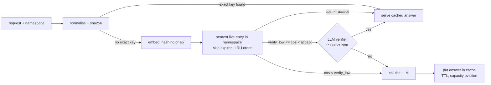

# llm-semantic-cache

[](https://github.com/Adversitas/llm-semantic-cache/actions/workflows/ci.yml)

A **semantic response cache for LLM applications** (`semcache`), and a measured answer to the
question every GenAI platform team asks before turning one on: *how many LLM calls does it save,
and how often does it serve the wrong answer?*

The cache answers a request from an earlier one when they mean the same thing: exact match on
normalised text first, then nearest neighbour on sentence embeddings, with **namespaces**
(tenant / user / model or prompt version, never crossed), **TTL**, **LRU capacity**, namespace
**invalidation**, and an optional **LLM verifier** that is only called in the "gray zone" between
a lower and an upper similarity threshold.

It is evaluated on French data built to break caches: **PAWS-X fr**, where non-paraphrases are
adversarial near-duplicates (swapped entities, reordered words) - exactly the pairs for which a
cache serves a wrong answer. Thresholds are always chosen on the dev split and reported on test.

## Results

All numbers below come from `reports/results.md` (one run on a laptop RTX 4060, Windows,
`Qwen2.5-1.5B-Instruct` in fp16 as verifier and generator, `multilingual-e5-small` as encoder).
PAWS-X fr: 2,000 dev + 2,000 test pairs (43 % / 45 % paraphrases). STS-B fr test: 1,379 pairs.

### Can similarity scores tell "same request" from "near-duplicate"?

| Scorer | PAWS-X fr test ROC-AUC | STS-B fr test Spearman | Cost per query |
|---|---|---|---|
| char 2-4-gram hashing (lexical baseline) | 0.549 | 0.653 | 0.9 ms |
| multilingual-e5-small cosine | 0.550 | 0.792 | 34.5 ms (single query) |
| Qwen2.5-1.5B-Instruct verifier, P("Oui") from one forward pass | **0.796** | - | 186 ms per call |

The encoder is much better than the lexical baseline at *graded* similarity (STS-B), but on
adversarial pairs both embedding scores are close to chance: "A beat B" and "B beat A" embed
almost identically. A small LLM reading both requests separates them far better.

### Cache decisions on PAWS-X fr test

Served = request answered from the cache; recall = share of true paraphrases served;
wrong answers are counted per 1,000 requests.

| Scorer | Policy | Target precision (dev) | Served % | Precision % | Recall % | Wrong / 1000 | Verifier calls % |
|---|---|---|---|---|---|---|---|
| e5 | threshold only | 0.95 | 1.5 | 93.1 | 3.0 | 1.0 | 0 |
| e5 | **threshold + LLM verifier in gray zone** | 0.95 | **3.1** | **96.8** | **6.8** | 1.0 | 9.4 |
| e5 | threshold only | 0.99 | 1.4 | 100.0 | 3.0 | 0.0 | 0 |
| e5 | threshold + LLM verifier | 0.99 | 1.6 | 100.0 | 3.4 | 0.0 | 2.2 |
| e5 | threshold + LLM verifier | 0.90 | 6.2 | 93.6 | 13.0 | 4.0 | 24.9 |
| hashing | threshold only | 0.95 | 0.2 | 75.0 | 0.3 | 0.5 | 0 |
| hashing | threshold + LLM verifier | 0.90 | 4.2 | 92.9 | 8.6 | 3.0 | 18.4 |

At the 95 % precision target the gray-zone verifier **more than doubles safe hits** (recall 3.0 % ->
6.8 %) for the same wrong-answer rate, while being called on fewer than 1 request in 10. The
honest headline is the other one, though: on adversarial wording, **an embedding-only cache can
only be trusted for near-identical text** (the dev-calibrated thresholds land at cosine ~0.999).

### Replay through the real `SemanticCache`

Every test `s1` is inserted (1,952 unique entries), every `s2` is looked up, 0.95-target threshold.
A hit is correct if the cached question is textually identical after normalisation, or is the
query's own labelled paraphrase; any other semantic hit is counted wrong (conservative).

| Encoder | Served % | Precision % | Wrong / 1000 | Lookup ms (excl. embedding) |
|---|---|---|---|---|
| hashing | 5.7 | 98.2 | 1.0 | 4.86 |
| e5 | 5.7 | 97.4 | 1.5 | 0.66 |

Most of those hits (111 of ~114) come from the exact-match route: PAWS-X reuses source sentences
across pairs, the same thing that makes exact-match caching worthwhile in production FAQ traffic.

### What a miss costs

Answering one of 5 French insurance questions with Qwen2.5-1.5B-Instruct (greedy, 160 new tokens
max) took **24.4 s and 150 tokens on average** on this machine, against 0.66 ms for a cache lookup
plus 34.5 ms of embedding, or about 186 ms when the verifier is called.

## Architecture



```
src/semcache/
  cache.py     SemanticCache: exact + semantic lookup, namespaces, TTL, LRU, invalidate, stats
  embed.py     HashingEmbedder (no download), TransformerEmbedder (e5), CachedEmbedder memo
  llm.py       LocalLLM: verifier P(yes) from last-token logits only, generator with timing
  evaluate.py  dev-calibrated thresholds, cascade grid search, replay, report rendering
  cli.py       `semcache evaluate` / `semcache demo`
data/          PAWS-X fr and STS-B fr dev/test as CSV (see Data)
reports/       results.json + results.md from the run above
```

## How to run

```bash
pip install -e ".[dev]"            # numpy, pandas, scikit-learn, scipy
pytest -q && ruff check . && ruff format --check .

semcache evaluate                  # lexical baseline only, no model download (what CI runs)
semcache demo "Comment déclarer un sinistre ?" "comment déclarer un sinistre" "Comment résilier mon contrat ?"

pip install -e ".[models]"         # torch + transformers
semcache evaluate --e5 --llm Qwen/Qwen2.5-1.5B-Instruct --gen-llm Qwen/Qwen2.5-1.5B-Instruct
```

Using the cache in an application:

```python
from semcache.cache import SemanticCache
from semcache.embed import TransformerEmbedder
from semcache.llm import LocalLLM

verifier = LocalLLM("Qwen/Qwen2.5-1.5B-Instruct")
cache = SemanticCache(
    TransformerEmbedder(), accept=1.0, verify_low=0.998,  # policy picked on dev for 95 % precision
    verifier=verifier.verifier(threshold=0.8), ttl_s=24 * 3600, capacity=50_000,
)
answer, lookup = cache.get_or_call(question, call_llm, namespace=f"{tenant}:{prompt_version}")
```

## Data

- **PAWS-X, French** (Yang et al., 2019; Google Research, Wikipedia-derived), dev and test splits
  as published (2,000 pairs each), columns `id, s1, s2, label`.
- **STS-B, French** from the multilingual machine-translated STS benchmark (`stsb_multi_mt`, fr),
  dev (1,500) and test (1,379) splits, columns `s1, s2, score` (0-5).

Both are committed under `data/` so the evaluation runs offline.

## Limitations

- PAWS-X sentences are Wikipedia statements, not user questions; it is a stress test for wrong
  answers, not a measure of real hit rates, which depend entirely on how repetitive the traffic is.
- One run, one machine, one seed; latencies are wall-clock on a shared laptop GPU (the 24 s answer
  time is slow for a 1.5B model and is reported as measured, not tuned).
- Policies are calibrated on 2,000 dev pairs; precision targets are met on test only approximately
  (93.1 % against a 95 % target for e5 threshold-only).
- The nearest-neighbour search is a brute-force matrix product per namespace: fine up to tens of
  thousands of entries, a real deployment would put an ANN index (FAISS, pgvector) behind
  `nearest()`.
- The verifier prompt is in French and was not tuned; a larger or fine-tuned verifier would likely
  do better than ROC-AUC 0.80.

## En bref (FR)

`semcache` est un cache sémantique pour applications LLM : correspondance exacte sur le texte
normalisé, puis plus proche voisin sur des embeddings, avec espaces de noms (client, version de
modèle ou de prompt), TTL, éviction LRU et un vérificateur LLM appelé uniquement dans la zone grise.
Mesuré sur PAWS-X fr (paires quasi identiques mais de sens différent), le cosinus d'embedding est
proche du hasard (AUC 0,55) alors que Qwen2.5-1.5B atteint 0,80 ; à 95 % de précision visée, la
cascade seuil + vérificateur LLM double les réponses servies sans erreur (rappel 3,0 % -> 6,8 %,
précision 96,8 %) en appelant le vérificateur sur 9,4 % des requêtes. Un appel LLM évité représente
environ 24 s de génération sur cette machine, contre moins d'une milliseconde de recherche en cache.

## License

MIT, see [LICENSE](LICENSE).
